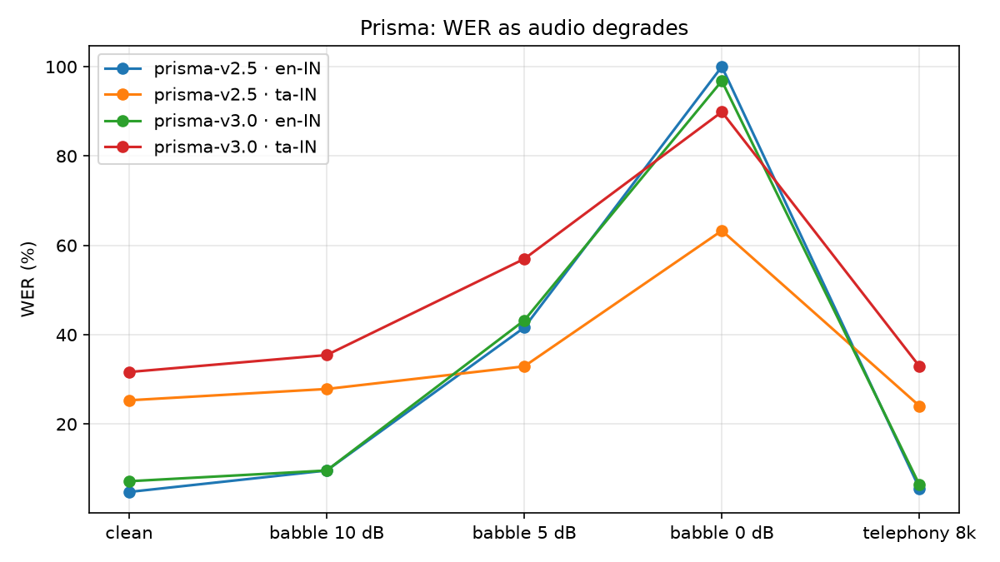
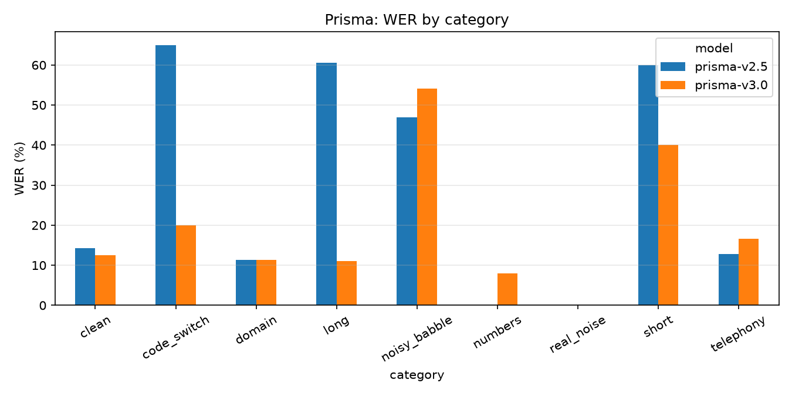

# Prisma (ASR) — results

WER/CER are corpus-level (total errors / total reference words or characters). `WER_raw` = transcript as returned; `WER_norm` = after identical normalisation of reference and hypothesis (case, punctuation, numbers → words for English, Hindi nukta).

## Overall (all categories)

| model       |   clips |   WER_raw |   WER_norm |   CER_norm |   sub_% |   del_% |   ins_% |   latency_p50_s |
|:------------|--------:|----------:|-----------:|-----------:|--------:|--------:|--------:|----------------:|
| prisma-v2.5 |     102 |     0.437 |      0.302 |      0.217 |  10.685 |  18.942 |   0.540 |           0.637 |
| prisma-v3.0 |     102 |     0.358 |      0.264 |      0.159 |  16.676 |   5.343 |   4.371 |           0.781 |

## By category and language

| model       | category     | language   |   clips |   WER_raw |   WER_norm |   CER_norm |   sub_% |   del_% |   ins_% |   latency_p50_s |
|:------------|:-------------|:-----------|--------:|----------:|-----------:|-----------:|--------:|--------:|--------:|----------------:|
| prisma-v2.5 | clean        | en-IN      |      12 |     0.370 |      0.182 |      0.148 |   3.346 |  14.498 |   0.372 |           0.595 |
| prisma-v3.0 | clean        | en-IN      |      12 |     0.256 |      0.100 |      0.046 |   5.576 |   2.974 |   1.487 |           0.794 |
| prisma-v2.5 | clean        | hi-IN      |      10 |     0.180 |      0.075 |      0.026 |   5.993 |   0.749 |   0.749 |           0.706 |
| prisma-v3.0 | clean        | hi-IN      |      10 |     0.176 |      0.082 |      0.028 |   6.742 |   0.749 |   0.749 |           0.803 |
| prisma-v2.5 | clean        | ta-IN      |      10 |     0.357 |      0.199 |      0.062 |  15.603 |   3.546 |   0.709 |           0.848 |
| prisma-v3.0 | clean        | ta-IN      |      10 |     0.336 |      0.255 |      0.075 |  18.440 |   3.546 |   3.546 |           0.779 |
| prisma-v2.5 | code_switch  | ta-IN      |       3 |     0.800 |      0.650 |      0.527 |  60.000 |   5.000 |   0.000 |           0.688 |
| prisma-v3.0 | code_switch  | ta-IN      |       3 |     0.250 |      0.200 |      0.053 |  20.000 |   0.000 |   0.000 |           0.656 |
| prisma-v2.5 | domain       | en-IN      |       4 |     0.434 |      0.109 |      0.025 |  10.909 |   0.000 |   0.000 |           0.731 |
| prisma-v3.0 | domain       | en-IN      |       4 |     0.245 |      0.109 |      0.025 |  10.909 |   0.000 |   0.000 |           0.764 |
| prisma-v2.5 | domain       | ta-IN      |       1 |     0.286 |      0.143 |      0.042 |  14.286 |   0.000 |   0.000 |           0.709 |
| prisma-v3.0 | domain       | ta-IN      |       1 |     0.143 |      0.143 |      0.042 |  14.286 |   0.000 |   0.000 |           0.564 |
| prisma-v2.5 | long         | en-IN      |       2 |     0.882 |      0.853 |      0.816 |   0.775 |  83.721 |   0.775 |           0.777 |
| prisma-v3.0 | long         | en-IN      |       2 |     0.110 |      0.062 |      0.031 |   3.876 |   0.000 |   2.326 |           1.048 |
| prisma-v2.5 | long         | ta-IN      |       2 |     0.390 |      0.203 |      0.117 |  17.722 |   1.266 |   1.266 |           0.693 |
| prisma-v3.0 | long         | ta-IN      |       2 |     0.273 |      0.190 |      0.107 |  17.722 |   0.000 |   1.266 |           1.109 |
| prisma-v2.5 | noisy_babble | en-IN      |      18 |     0.593 |      0.504 |      0.458 |   6.667 |  43.733 |   0.000 |           0.604 |
| prisma-v3.0 | noisy_babble | en-IN      |      18 |     0.593 |      0.499 |      0.356 |  25.600 |  17.600 |   6.667 |           0.809 |
| prisma-v2.5 | noisy_babble | ta-IN      |      18 |     0.538 |      0.414 |      0.201 |  29.536 |  10.970 |   0.844 |           0.660 |
| prisma-v3.0 | noisy_babble | ta-IN      |      18 |     0.688 |      0.608 |      0.347 |  41.772 |   4.641 |  14.346 |           0.829 |
| prisma-v2.5 | numbers      | en-IN      |       3 |     0.158 |      0.000 |      0.000 |   0.000 |   0.000 |   0.000 |           0.837 |
| prisma-v3.0 | numbers      | en-IN      |       3 |     0.079 |      0.079 |      0.078 |   0.000 |   0.000 |   7.895 |           0.763 |
| prisma-v2.5 | real_noise   | en-IN      |       2 |     0.148 |      0.000 |      0.000 |   0.000 |   0.000 |   0.000 |           0.601 |
| prisma-v3.0 | real_noise   | en-IN      |       2 |     0.000 |      0.000 |      0.000 |   0.000 |   0.000 |   0.000 |           0.817 |
| prisma-v2.5 | short        | en-IN      |       3 |     1.000 |      0.333 |      0.222 |  33.333 |   0.000 |   0.000 |           0.466 |
| prisma-v3.0 | short        | en-IN      |       3 |     0.000 |      0.000 |      0.000 |   0.000 |   0.000 |   0.000 |           0.470 |
| prisma-v2.5 | short        | ta-IN      |       2 |     2.000 |      1.000 |      1.364 |   0.000 |   0.000 | 100.000 |           0.617 |
| prisma-v3.0 | short        | ta-IN      |       2 |     1.000 |      1.000 |      1.364 |   0.000 |   0.000 | 100.000 |           0.487 |
| prisma-v2.5 | telephony    | en-IN      |       6 |     0.236 |      0.056 |      0.025 |   4.800 |   0.800 |   0.000 |           0.558 |
| prisma-v3.0 | telephony    | en-IN      |       6 |     0.179 |      0.064 |      0.033 |   4.800 |   1.600 |   0.000 |           0.691 |
| prisma-v2.5 | telephony    | ta-IN      |       6 |     0.385 |      0.241 |      0.082 |  18.987 |   5.063 |   0.000 |           0.638 |
| prisma-v3.0 | telephony    | ta-IN      |       6 |     0.410 |      0.329 |      0.097 |  24.051 |   6.329 |   2.532 |           0.766 |

## Robustness: same clips, degraded

| model       | language   | condition    |   clips |   WER_norm |   CER_norm |
|:------------|:-----------|:-------------|--------:|-----------:|-----------:|
| prisma-v2.5 | en-IN      | clean        |       6 |      0.048 |      0.018 |
| prisma-v2.5 | en-IN      | babble 10 dB |       6 |      0.096 |      0.040 |
| prisma-v2.5 | en-IN      | babble 5 dB  |       6 |      0.416 |      0.335 |
| prisma-v2.5 | en-IN      | babble 0 dB  |       6 |      1.000 |      1.000 |
| prisma-v2.5 | en-IN      | telephony 8k |       6 |      0.056 |      0.025 |
| prisma-v2.5 | ta-IN      | clean        |       6 |      0.253 |      0.083 |
| prisma-v2.5 | ta-IN      | babble 10 dB |       6 |      0.278 |      0.089 |
| prisma-v2.5 | ta-IN      | babble 5 dB  |       6 |      0.329 |      0.123 |
| prisma-v2.5 | ta-IN      | babble 0 dB  |       6 |      0.633 |      0.392 |
| prisma-v2.5 | ta-IN      | telephony 8k |       6 |      0.241 |      0.082 |
| prisma-v3.0 | en-IN      | clean        |       6 |      0.072 |      0.030 |
| prisma-v3.0 | en-IN      | babble 10 dB |       6 |      0.096 |      0.047 |
| prisma-v3.0 | en-IN      | babble 5 dB  |       6 |      0.432 |      0.305 |
| prisma-v3.0 | en-IN      | babble 0 dB  |       6 |      0.968 |      0.716 |
| prisma-v3.0 | en-IN      | telephony 8k |       6 |      0.064 |      0.033 |
| prisma-v3.0 | ta-IN      | clean        |       6 |      0.316 |      0.098 |
| prisma-v3.0 | ta-IN      | babble 10 dB |       6 |      0.354 |      0.162 |
| prisma-v3.0 | ta-IN      | babble 5 dB  |       6 |      0.570 |      0.310 |
| prisma-v3.0 | ta-IN      | babble 0 dB  |       6 |      0.899 |      0.570 |
| prisma-v3.0 | ta-IN      | telephony 8k |       6 |      0.329 |      0.097 |

## Numbers with `format=transcribe` (entity exact match)

| model       | clip_id     | expected_entities   | hypothesis                                             |   entities_ok |   entities_total |
|:------------|:------------|:--------------------|:-------------------------------------------------------|--------------:|-----------------:|
| prisma-v2.5 | own_num_01  | 45789213            | my policy number is 45789213                           |             1 |                1 |
| prisma-v2.5 | own_num_02  | 9840123456          | my mobile number is 9840123456                         |             1 |                1 |
| prisma-v2.5 | own_num_03  | 12500|5             | i paid ₹12,500 on 5th March                            |             2 |                2 |
| prisma-v2.5 | own_real_02 | 9840123456          | my mobile number is 9840123456                         |             1 |                1 |
| prisma-v3.0 | own_num_01  | 45789213            | My policy number is 45789213.                          |             1 |                1 |
| prisma-v3.0 | own_num_02  | 9840123456          | My mobile number is 9840123456.                        |             1 |                1 |
| prisma-v3.0 | own_num_03  | 12500|5             | I paid 12,500 rupees on the 5th on month 5th of March. |             2 |                2 |
| prisma-v3.0 | own_real_02 | 9840123456          | My mobile number is 9840123456.                        |             1 |                1 |

| model       |   entities_ok |   entities_total |   accuracy |
|:------------|--------------:|-----------------:|-----------:|
| prisma-v2.5 |             5 |                5 |      1.000 |
| prisma-v3.0 |             5 |                5 |      1.000 |

## Domain terms: with vs without context hints

| model       | clip_id    |   WER_no_context |   WER_with_context |   term_recall_no_context |   term_recall_with_context |
|:------------|:-----------|-----------------:|-------------------:|-------------------------:|---------------------------:|
| prisma-v2.5 | own_dom_01 |            0.154 |              0.077 |                    0.667 |                      1.000 |
| prisma-v2.5 | own_dom_02 |            0.071 |              0.071 |                    1.000 |                      1.000 |
| prisma-v2.5 | own_dom_03 |            0.091 |              0.091 |                    1.000 |                      1.000 |
| prisma-v2.5 | own_dom_04 |            0.118 |              0.118 |                    1.000 |                      1.000 |
| prisma-v2.5 | own_dom_05 |            0.143 |              0.143 |                    0.000 |                      0.000 |
| prisma-v3.0 | own_dom_01 |            0.077 |              0.077 |                    1.000 |                      1.000 |
| prisma-v3.0 | own_dom_02 |            0.071 |              0.071 |                    1.000 |                      1.000 |
| prisma-v3.0 | own_dom_03 |            0.091 |              0.091 |                    1.000 |                      1.000 |
| prisma-v3.0 | own_dom_04 |            0.176 |              0.118 |                    0.667 |                      1.000 |
| prisma-v3.0 | own_dom_05 |            0.143 |              0.000 |                    0.000 |                      1.000 |

## Language detection (`indic-auto`, v3.0)

| language   |   clips |   accuracy |   WER_norm_auto |
|:-----------|--------:|-----------:|----------------:|
| en-IN      |      12 |      1.000 |           0.116 |
| hi-IN      |      10 |      1.000 |           0.076 |
| ta-IN      |      10 |      1.000 |           0.252 |

_(no rows)_

## Latency (REST, measured from client)

| model       |   calls |   client_p50_s |   client_p95_s |   server_proc_p50_s |   server_proc_p95_s |   server_RTF_p50 |
|:------------|--------:|---------------:|---------------:|--------------------:|--------------------:|-----------------:|
| prisma-v2.5 |     102 |          0.637 |          0.889 |               0.200 |               0.379 |            0.021 |
| prisma-v3.0 |     102 |          0.781 |          1.020 |               0.361 |               0.571 |            0.038 |

## Worst clips (normalised)

- **prisma-v3.0 · ta_babble_snr0_04** (noisy_babble, ta-IN) WER 1.53
  - REF: துணி மிகவும் வெப்பமடைதலை அனுமதிக்காதபடி கவனமாக இருக்கவும் அதனால் துணி சுருங்கலாம் அல்லது தீவிர நிகழ்வுகளில் துணி தீயில் வாட்டப்படலாம்
  - HYP: ஆளுநர் அதிகாரம் கொண்டு ஒரு படி கோரும் ஆளுநர் அதிகாரி அலுவலகத்தில் வெளியே வருகிறவர்களுக்கு இதுவே தாளமாக அமையும் நூற்றாண்டுகளில் மற்றும் ஐரோப்பிய வரலாற்றில் அமெரிக்கர்கள் தீவிரவாதத்தை ஒரு வழி கொண்டு

- **prisma-v3.0 · ta_babble_snr5_04** (noisy_babble, ta-IN) WER 1.33
  - REF: துணி மிகவும் வெப்பமடைதலை அனுமதிக்காதபடி கவனமாக இருக்கவும் அதனால் துணி சுருங்கலாம் அல்லது தீவிர நிகழ்வுகளில் துணி தீயில் வாட்டப்படலாம்
  - HYP: கலைஞர் அதிகாரம் பெற்ற ஒரு எளிய மக்கள் நல்லாட்சிகள் ஆளுநர் முதலமைச்சர் அரசு பொறுப்புகள் மீது கவனமாக இருக்கவும் அதனால் இருந்தாலும் நமது தீவிர முறைகளில் துணிச்சியால் வாடப்படலாம் ஒரு வெடிகுண்டு

- **prisma-v3.0 · en_babble_snr0_01** (noisy_babble, en-IN) WER 1.24
  - REF: all nouns alongside the word sie for you always begin with a capital letter even in the middle of a sentence
  - HYP: the whole now is a nice time to get an exercise calendar and you can use the calendar to plan your activities so what do you do

- **prisma-v3.0 · ta_babble_snr0_01** (noisy_babble, ta-IN) WER 1.22
  - REF: லக்கா சிங் பஜனையை வழங்கினார் பாடகர் ராஜு கண்டெல்வலும் அவருடன் வந்திருந்தார்
  - HYP: லக்கச்சன் பஜனை வளவாளர் பாடகர் ராஜன் என்ற அந்தஸ்து கொண்டவர்களுடன் அவருடைய ஜென்மம் வந்திருந்தது

- **prisma-v3.0 · en_babble_snr0_05** (noisy_babble, en-IN) WER 1.05
  - REF: the hospital has followed protocol for infection control including separating the patient from others to prevent possible infection of others
  - HYP: the hospital has followed strict guidelines to ensure that patients are not exposed to any infection or other risk hospitalization and the treatment of the patient

- **prisma-v2.5 · en_babble_snr0_04** (noisy_babble, en-IN) WER 1.00
  - REF: many people don t think about them as dinosaurs because they have feathers and can fly
  - HYP: 

- **prisma-v2.5 · en_babble_snr0_02** (noisy_babble, en-IN) WER 1.00
  - REF: to the north and within easy reach is the romantic and fascinating town of sintra and which was made famous to foreigners after a glowing account of its splendours recorded by lord byron
  - HYP: 

- **prisma-v2.5 · en_babble_snr0_03** (noisy_babble, en-IN) WER 1.00
  - REF: the cabbage juice changes color depending on how acidic or basic alkaline the chemical is
  - HYP: 

- **prisma-v2.5 · en_babble_snr0_00** (noisy_babble, en-IN) WER 1.00
  - REF: however due to the slow communication channels styles in the west could lag behind by twenty five to thirty year
  - HYP: 

- **prisma-v3.0 · ta_babble_snr0_02** (noisy_babble, ta-IN) WER 1.00
  - REF: முக்கியமான மேடைகளில் இசை நிகழ்ச்சி முடிந்திருந்தாலும் விழாவின் சில பிரிவுகள் இரவு இசைப்பதைத் தொடரும்
  - HYP: நிகழ்வுகள் நிகழ்ந்த முக்கியமான மேடைகளில் அது இதே நிகழ்ச்சி முடிந்திருந்தாலும் விழாவின் சில விரிவுகள் இறங்கு சீர்ப்பதை தொடரும் அல்லது ஒரு வழி கொண்டு

- **prisma-v3.0 · en_babble_snr0_04** (noisy_babble, en-IN) WER 1.00
  - REF: many people don t think about them as dinosaurs because they have feathers and can fly
  - HYP: sondikku pakka njan kandittu enikku tharvatha

- **prisma-v3.0 · en_babble_snr0_00** (noisy_babble, en-IN) WER 1.00
  - REF: however due to the slow communication channels styles in the west could lag behind by twenty five to thirty year
  - HYP: my card expiry date is expired can you tell me the reason why

**prisma-v2.5** — top substitutions: `ph → பிஹெச்`×5, `அந்தப் → அந்த`×5, `திட்டமிடப் → செயல்பட`×5, `year → years`×4, `the → a`×4, `இசைப்பதைத் → இசைப்பதை`×4, `2017 → ரெண்டாயிரத்தி`×4, `பட்டுள்ளது → திட்டமிடப்பட்டுள்ளது`×4, `வாட்டப்படலாம் → வாடப்படலாம்`×4, `word → world`×3, `sie → say`×3, `splendours → splendorous`×3

**prisma-v2.5** — top deletions: `the`×21, `to`×12, `in`×10, `of`×10, `2`×10, `and`×8, `a`×6, `or`×6

**prisma-v2.5** — top insertions: `செப்டம்பர்`×2, `free`×1, `mariana`×1, `रख`×1, `प्राचीन`×1, `வேண்டாம்`×1, `இல்லை`×1, `ஒது`×1

**prisma-v3.0** — top substitutions: `அந்தப் → அந்த`×5, `its → the`×4, `year → years`×4, `ph → பிஹெச்`×4, `பஜனையை → பஜனியை`×4, `இசைப்பதைத் → இசைப்பதை`×4, `word → world`×3, `இல் → பதினேழில்`×3, `சோதனைச் → சோதனை`×3, `திட்டமிடப் → செயல்பட`×3, `பட்டுள்ளது → திட்டமிடப்பட்டுள்ளது`×3, `glowing → growing`×2

**prisma-v3.0** — top deletions: `2`×9, `to`×7, `the`×5, `and`×4, `many`×4, `or`×4, `ஹம்ப்பேக்`×4, `லக்கா`×4

**prisma-v3.0** — top insertions: `the`×6, `செப்டம்பர்`×4, `ஒரு`×3, `ஆளுநர்`×3, `on`×2, `and`×2, `mariana`×2, `அது`×2

## Failed requests

| model       | tag   | clip_id         | category   |   status | error                                                                                                                                            |
|:------------|:------|:----------------|:-----------|---------:|:-------------------------------------------------------------------------------------------------------------------------------------------------|
| prisma-v2.5 | main  | en_overlimit_00 | over_limit |      400 | {"success": false, "error": {"type": "MAX_AUDIO_DURATION_EXCEEDED", "message": "Audio duration exceeds maximum allowed duration of 30 seconds"}} |
| prisma-v3.0 | main  | en_overlimit_00 | over_limit |      400 | {"success": false, "error": {"type": "MAX_AUDIO_DURATION_EXCEEDED", "message": "Audio duration exceeds maximum allowed duration of 30 seconds"}} |
